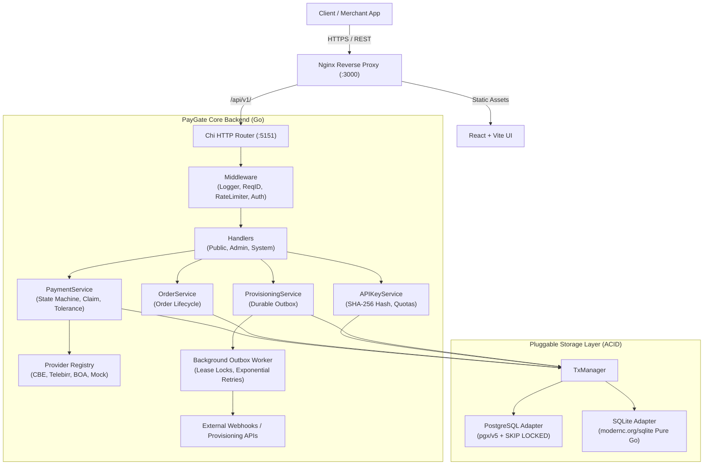
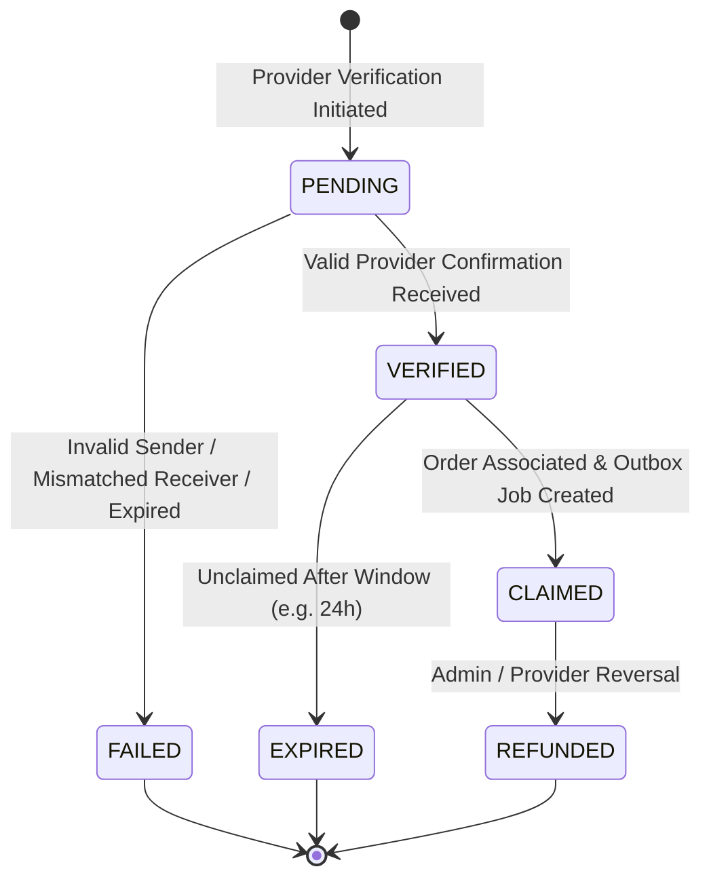

# PayGate Architecture Specification

PayGate is a standalone, production-grade, open-source payment verification and automated provisioning platform. Designed with low infrastructure requirements and financial correctness as the top priority, PayGate separates verification business logic from underlying database and payment provider implementations.



---

## 1. Pluggable Database Architecture

PayGate decouples business logic from persistence using repository interfaces (`internal/domain/repository.go`).

```go
type PaymentRepository interface {
    GetByID(ctx context.Context, id string) (*Payment, error)
    GetByTxID(ctx context.Context, txID string) (*Payment, error)
    Create(ctx context.Context, p *Payment) error
    Update(ctx context.Context, p *Payment) error
    ClaimPayment(ctx context.Context, txID, orderID, customerID string) (*Payment, error)
    List(ctx context.Context, filter PaymentFilter) ([]Payment, int64, error)
    GetStats(ctx context.Context) (*PaymentStats, error)
}
```

### PostgreSQL Engine (`internal/database/postgres`)
- **Driver:** `jackc/pgx/v5` with connection pooling (`pgxpool`).
- **Concurrent Job Leases:** Employs `SELECT ... FOR UPDATE SKIP LOCKED` to safely claim pending provisioning outbox jobs across multiple worker replicas without lock contention or duplicate execution.
- **Transactions:** Full ACID multi-statement transactions managed via context injection.

### SQLite Engine (`internal/database/sqlite`)
- **Driver:** `modernc.org/sqlite` (Pure Go, 100% CGO-free, statically compiled).
- **Concurrency & Locking:** Configured with `PRAGMA journal_mode=WAL;` and `PRAGMA busy_timeout=5000;`. Single-writer concurrency is enforced.
- **Atomic Claiming:** Implements conditional updates `UPDATE payments SET claimed = 1, claimed_by = ?, claimed_at = ? WHERE tx_id = ? AND claimed = 0` returning modified row counts to guarantee single-claim idempotency without row locks.

### In-Memory Ephemeral Engine (`internal/database/memory`)
- **Zero-Dependency Fallback:** If no database is configured or connection to external storage fails, PayGate starts immediately in-memory with a visible safety warning.
- **Thread-Safe Memory Storage:** Employs `sync.RWMutex` maps, transactional snapshots (`memTx` staged mutations), and full conformance with all repository contracts.

### Dynamic Database Manager (`internal/database/manager.go`)
- **Zero-Downtime Switching:** Allows operators or developers to point PayGate to an external PostgreSQL or SQLite database directly from the Web UI or REST API without restarting the backend process.
- **Auto-Migration:** Target databases are automatically migrated on connect, and existing administrator credentials are seeded smoothly.

---

## 2. Payment State Machine & Financial Invariants

PayGate enforces an explicit, unidirectional state machine for all payment transactions:



### Invariants:
1. **Uniqueness:** A transaction identifier (`tx_id`) cannot be created more than once (enforced by `UNIQUE(tx_id)` at database level).
2. **Single Claim Guarantee:** A payment can only transition to `CLAIMED` once. Subsequent claim attempts return `ErrPaymentAlreadyClaimed`.
3. **Amount Tolerance:** To prevent customer drop-off due to micro-deductions (e.g. bank transfer fees), PayGate supports an asymmetric tolerance window:
   $$\text{Required Amount} - 1.00 \le \text{Verified Amount} \le \text{Required Amount} + 5.00$$
4. **Merchant Account Matching:** The recipient receiver name or account number extracted from provider slips must match the merchant's configured identity (`internal/provider/cleaner.go`).

---

## 3. Durable Provisioning Outbox Pattern

To prevent the **Dual-Write Problem** (where a payment commits to the database but an external provisioning webhook or API call fails), PayGate uses a durable transactional outbox:

1. **Transactional Enqueue:** When an order is verified or claimed, the payment state change and the provisioning job row are committed in the same database transaction.
2. **Worker Lease Polling:** The background worker polls for `PENDING` or `FAILED` jobs whose `next_retry_at <= NOW()`.
3. **Lease Locking:**
   - PostgreSQL uses `FOR UPDATE SKIP LOCKED`.
   - SQLite uses atomic status updates with lease expiration timestamps.
4. **Exponential Backoff:** If a downstream provisioning webhook fails or times out, the worker reschedules the job with exponential backoff:
   $$\text{delay} = 2^{\text{attempts}} \times 2\,\text{seconds} \quad (\text{up to } 5 \text{ retries})$$
5. **Signed Webhook Dispatch:** Provisioning webhooks are signed using `HMAC-SHA256` with the merchant's webhook secret, allowing downstream services to verify authenticity.
